# Дизайн-специфікація: Веб-додаток «Похідний Завгосп» (Теорія харчування + Інтерактивний калькулятор розкладки)

**Дата:** 2026-11-03  
**Статус:** Погоджено архітектурний підхід (Варіант 1 — Модульний SPA/PWA на React + TypeScript + Vite)  
**Базові першоджерела у робочій області (`f:\raskl`):**
1. В. Хачикян — *«Составление раскладки для горных спортивных походов 1-2 к.с.»* ([`NU22 Pitanie. Hachikyan V.pdf`](file:///f:/raskl/NU22%20Pitanie.%20Hachikyan%20V.pdf))
2. О. О. Алексєєв — *«Питание в туристском походе»* ([`avidreaders.ru__pitanie-v-turistskom-pohode.epub`](file:///f:/raskl/avidreaders.ru__pitanie-v-turistskom-pohode.epub))
3. Linda Frederick Yaffe — *«Backpack Gourmet: Good Hot Grub You Can Make at Home, Dehydrate, and Pack»* ([`Backpack_Gourmet.pdf`](file:///f:/raskl/Backpack_Gourmet.pdf))
4. Horace Kephart — *«Camp Cookery»* ([`campcookery01keph.pdf`](file:///f:/raskl/campcookery01keph.pdf))

---

## 1. Намір та Призначення (Intent and the Why)

Організація харчування у багатоденному туристичному поході — одна з найвідповідальніших і найбільш трудомістких задач завгоспа групи. Традиційно завгоспи використовують громіздкі таблиці Excel, вручну звіряючи калорійність, баланс білків/жирів/вуглеводів (БЖВ), клітковину, коефіцієнти усушки домашніх страв, розбивку маршруту на кільця з урахуванням забросок та справедливий розподіл ваги по рюкзаках учасників.

**Мета проєкту:** Створити автономний (offline-first) веб-додаток, який поєднує:
1. **Стислий структурований теоретичний довідник** із похідного харчування, синтезований на основі чотирьох класичних та сучасних джерел (фізіологія енерговитрат, норми БЖВ за кліматом і висотою, «плаваюча» розкладка та акліматизаційна крива, водно-сольовий режим, вітамінізація, технологія домашнього сушіння страв одного казана, фізика готування на висоті та пакування).
2. **Повноцінний робочий інструмент завгоспа** з конструктором меню по днях та прийомах їжі, вбудованою базою продуктів та рецептів сушених страв, автоматичним перерахунком сухої ваги у сиру для списку покупок, обліком забросок (етапів/кілець), розподілом ваги по учасниках з урахуванням коефіцієнтів вантажопідйомності та експортом готових відомостей у таблиці (`.xlsx` / `.csv`) і друкований PDF.

---

## 2. Цілі, Не-цілі та Анти-цілі (Goals, Non-Goals, Anti-Goals)

### Цілі (Goals)
- **Автономність у браузері:** Повна працездатність без сервера, реєстрації чи підключення до інтернету після першого завантаження (SPA з локальним збереженням у `IndexedDB` / `localStorage` та імпортом/експортом проєктів у `.json`).
- **Науково обґрунтоване планування:** Автоматичний контроль цільових норм ваги, калорійності, співвідношення Б:Ж:В (1:1:4 для літніх походів, 1:0.7:4 / 1:0.7:5 для високогір'я та спеки, 1:2:3 / 1:3:4 для зими), клітковини (15–20 г/день), води та палива (газ/бензин) з попередженнями при відхиленнях.
- **Підтримка «плаваючої» розкладки:** Можливість задавати тип дня (акліматизаційний/втягуючий, основний ходовий, штурмовий, післяштурмовий, дньовка) з автоматичним коригуванням рекомендованої норми калорій та вуглеводів/жирів за методикою О. Алексєєва та В. Хачикяна.
- **Цикл «Суха розкладка → Сира закупка та сушіння»:** Вбудована база рецептів сушених страв (за *Backpack Gourmet* та практикою гірського туризму) із коефіцієнтами усушки, що автоматично генерує список покупок у сирій вазі та план роботи з дегідратором (температура, час сушіння, тест готовності).
- **Облік забросок та розподіл по рюкзаках:** Розбиття походу на незалежні етапи (кільця між забросками) та розподіл продуктів і спорядження між учасниками пропорційно їхнім коефіцієнтам вантажопідйомності (0.5–1.3) із рівномірним зменшенням ваги рюкзаків щодня.
- **Експорт для групи:** Генерація багатоаркушевого файлу `.xlsx` (меню, закупка, розподіл по учасниках, опис забросок, етикетки пакування) та форматованого PDF для друку або надсилання в месенджер групи.

### Не-цілі (Non-Goals)
- Серверна синхронізація у реальному часі між кількома пристроями (достатньо обміну файлом проєкту `.json` та експорту `.xlsx`/PDF).
- Облік фінансових взаєморозрахунків у різних валютах зі складним спліт-білінгом (достатньо базової оцінки бюджету закупки в одній валюті).
- GPS-навігація чи побудова треків на карті.

### Анти-цілі (Anti-Goals)
- **Перевантаження інтерфейсу модальною бюрократією:** Додавання продукту в прийом їжі або зміна грамовки на людину має відбуватися в 1 клік / інлайн-редагуванням прямо в таблиці розкладки, без багатокрокових майстрів на кожну дію.
- **Приховування формул розрахунку:** Кожна підсумкова цифра (вага брутто, % пакування, сира вага для закупки, ккал, БЖВ, норма газу) повинна бути прозорою та зрозумілою завгоспу.

---

## 3. Обмеження (Constraints)

- **Мова інтерфейсу та контенту:** Українська (весь інтерфейс, теоретичний довідник, назви продуктів, рецепти та експортовані документи).
- **Технологічний стек:**
  - Node.js / Vite 5+, React 18+, TypeScript 5+ (strict mode).
  - Стилізація: Tailwind CSS + Lucide React (іконки).
  - Стейт-менеджмент та персистентність: Zustand з middleware `persist` (`localStorage` / `IndexedDB` через `idb-keyval`).
  - Експорт таблиць: `xlsx` (SheetJS) для генерації багатоаркушевих `.xlsx` книг.
  - Друк / PDF: Спеціалізовані CSS `@media print` стилі + вікно попереднього перегляду друку (забезпечує ідеальну підтримку кирилиці без роздуття бандлу шрифтами) та опціональний програмний експорт.
  - Тестування: Vitest + React Testing Library для модульного тестування всіх формул розрахунку та компонентів.
- **Збереження вихідних книг:** Чотири файли першоджерел у корені `f:\raskl` залишаються недоторканими.

---

## 4. Обрана Архітектура (Selected Approach)

Додаток будується як модульний односторінковий веб-додаток (SPA/PWA) з чітким розділенням на 4 шари:

```mermaid
flowchart TD
    subgraph DataLayer["1. Шар статичних знань та бази даних (src/data)"]
        Theory["theoryChapters.ts\n(Стисла теорія з 4 книг)"]
        Products["productsCatalog.ts\n(80+ продуктів: БЖВ, ккал, клітковина, % засвоєння, усушка, тара)"]
        Recipes["dehydratedRecipes.ts\n(30+ рецептів сушених страв за Backpack Gourmet та Хачикяном)"]
        Presets["rationTemplates.ts\n(Шаблони походів та норми БЖВ за кліматом/висотою)"]
    end

    subgraph DomainLayer["2. Ядро розрахунків — чисті функції (src/domain)"]
        NutriCalc["nutritionCalculator.ts\n(БЖВ, ккал, клітковина, вага нетто/брутто, плаваюча норма)"]
        Validation["rationValidator.ts\n(Перевірка дефіциту білка/клітковини, повторів страв, перевищення ваги)"]
        ShopCalc["shoppingAndDryingCalculator.ts\n(Перерахунок сухої ваги у сиру, чек-лист сушарки)"]
        LoadDist["loadDistributor.ts\n(Розподіл ваги по етапах/забросках та учасниках за коефіцієнтами)"]
        FuelCalc["waterAndFuelCalculator.ts\n(Норма води та газу/бензину з урахуванням висоти і снігу)"]
    end

    subgraph StateLayer["3. Стан та Персистентність (src/store)"]
        ZustandStore["useProjectStore.ts\n(Поточний проєкт, автозбереження, Undo, JSON імпорт/експорт)"]
    end

    subgraph UILayer["4. Інтерфейс користувача та Експорт (src/components & src/export)"]
        HeaderNav["Навігація + Панель швидкої аналітики походу"]
        TabTheory["Вкладка 1: Стисла теорія та Калькулятор норм"]
        TabSetup["Вкладка 2: Налаштування маршруту, Етапів (Забросок) та Учасників"]
        TabMenu["Вкладка 3: Матриця розкладки (Дні × Прийоми їжі)"]
        TabRecipes["Вкладка 4: Каталог сушених страв і Продуктів"]
        TabShopping["Вкладка 5: Список покупок та План сушіння"]
        TabDistribution["Вкладка 6: Розподіл по рюкзаках, Пакування та Експорт (.xlsx / PDF)"]
    end

    DataLayer --> DomainLayer
    DomainLayer --> StateLayer
    StateLayer --> UILayer
```

---

## 5. Доменна Модель та Детальна Специфікація Функціоналу

### 5.1. Схема даних (TypeScript Interfaces)

#### A. Продукт (`Product`)
Кожен продукт у каталозі (`productsCatalog.ts`, базований на Додатку 1 О. Алексєєва, таблицях В. Хачикяна та класифікації вологості Г. Кепхарта) містить:
- `id: string`
- `name: string` (напр., «Крупа гречана», «М'ясо яловиче сушене (фарш)», «Сало солоне», «Висівки вівсяні»)
- `category: 'grains' | 'meat_fish' | 'dairy_eggs' | 'fats' | 'sweets' | 'dried_fruits_nuts' | 'vegetables_mushrooms' | 'bread_crackers' | 'soups_concentrates' | 'drinks_spices' | 'supplements'`
- `kcalPer100g: number`
- `proteinPer100g: number` (г)
- `fatPer100g: number` (г)
- `carbsPer100g: number` (г)
- `fiberPer100g: number` (г — критично за Хачикяном, норма 15–20 г/день)
- `digestibilityPercent: number` (% засвоюваності / їстівної частини за Алексєєвим, напр. 96% для сублімованого м'яса, 32% для яловичої тушонки)
- `waterContentClass: 'very_low_under_20' | 'low_20_33' | 'medium_33_50' | 'high_50_75' | 'very_high_over_75'` (за Кепхартом)
- `recommendedNormGrams: { min: number; default: number; max: number }` (рекомендована разова порція в грамах сухої/похідної ваги на 1 ос.)
- `packagingTareRatio: number` (коефіцієнт маси упаковки, за замовчуванням `0.05` для ПЕТ/пакетів, `0.15`–`0.25` для жерстяних банок)
- `packagingType: string` (рекомендація з пакування за Алексєєвим/Хачикяном: ПЕТ-пляшка з широким горлом, тетрапак, тканинний мішечок, пергамент + фольга тощо)
- `dryingInfo?: { rawToDryRatio: number; rawProductName: string; tempCelsius: string; timeHours: string; drynessTest: string; prepNotes: string }` (якщо продукт готується сушінням вдома: напр., варений яловичий фарш має `rawToDryRatio: 3.3`, тобто з 330 г сирого м'яса виходить 100 г сушеного).
- `isIndivisiblePkg?: boolean` (чи ділиться упаковка по днях, чи несеться цілою банкою/пачкою).

#### B. Рецепт сушеної страви (`DehydratedRecipe`)
Базований на книзі *Backpack Gourmet* (Linda Frederick Yaffe) та рецептах Хачикяна:
- `id: string`
- `title: string` (напр., «Чілі Кон Карне по-каньйонськи (Canyon Country Chili)», «Борщ домашній сушений», «Паста Сичуань з кунжутом», «Картопляна запіканка з сиром та шинкою», «Хумус швидкого приготування», «Фруктова пастила яблучно-полунична»)
- `mealTypes: ('breakfast' | 'lunch' | 'dinner' | 'snack')[]`
- `servingsYield: number` (на скільки порцій розрахований базовий рецепт)
- `dryWeightPerServingGrams: number` (вага 1 сухої порції в поході, г)
- `kcalPerServing: number`, `proteinPerServing: number`, `fatPerServing: number`, `carbsPerServing: number`, `fiberPerServing: number`
- `rawIngredients: { name: string; amount: number; unit: string; category: string }[]` (точний список сирих продуктів для закупки вдома)
- `homePrepSteps: string[]` (приготування вдома без зайвого жиру)
- `dehydrationParams: { tempCelsius: number; timeHours: string; trayLining: string; drynessTest: string }` (напр., 63°C / 145°F, 6–10 год, тест на сухість)
- `campRehydration: { waterRatioNote: string; soakMinutes: number; boilMinutes: number; altitudeNote?: string }` (відновлення в таборі: залити водою на 1–2 см вище рівня, довести до кипіння, варити 3 хв).
- `packagingTareRatio: number` (за замовчуванням `0.05` для фасованих у пакети сушених страв; при зміні `gramsPerPerson` у меню всі нутрієнти та сирі інгредієнти рецепта масштабуються пропорційно коефіцієнту `gramsPerPerson / dryWeightPerServingGrams`).

#### C. Проєкт походу (`HikeProject`)
- `id: string`, `name: string`, `createdAt: string`, `updatedAt: string`
- `settings`:
  - `hikeType: 'hiking' | 'mountain' | 'ski' | 'water'` (піший, гірський, лижний, водний)
  - `difficultyCategory: 1 | 2 | 3 | 4 | 5 | 6`
  - `climateProfile: 'temperate_1_1_4' | 'high_mountain_hot_1_07_4' | 'high_pamir_1_07_5' | 'cold_winter_1_2_3' | 'extreme_winter_1_3_4'`
  - `maxAltitudeMeters: number` (впливає на температуру кипіння води, потребу в автоклаві та норму палива)
  - `targetDailyWeightNetGrams: number` (напр., 550–650 г для гірського походу з сушкою, 700–850 г стандарт)
  - `targetDailyKcal: number` (базова цільова калорійність, напр. 2500–3200 ккал)
  - `fuelType: 'gas' | 'liquid_fuel' | 'campfire'`
  - `meltsSnowForWater: boolean` (чи потрібно топити сніг/лід — збільшує витрату палива)
- `participants: Participant[]`:
  - `id: string`, `name: string`, `gender: 'M' | 'F'`
  - `carryingCapacityCoeff: number` (за Алексєєвим/Хачикяном: `1.0` — середній чоловік, `0.6–0.8` — жінка, `0.8–1.0` — керівник, до `1.2–1.3` — сильний учасник)
  - `role: string` (Керівник, Завгосп, Медик, Реммайстер, Учасник)
  - `dietaryRestrictions: string` (алергії, вегетаріанство, продукти-виключення за анкетою Хачикяна)
  - `assignedSharedGearWeightGrams: number` (вага громадського спорядження, закріпленого за учасником, щоб вирівняти загальну вагу рюкзака `Спорядження + Їжа` за карткою розподілу Алексєєва)
- `stages: RouteStage[]` (Етапи / Кільця між забросками):
  - `id: string`, `name: string` (напр., «Кільце 1: Дні 1–4 (Старт – притулок)», «Заброска 1: Дні 5–9 (Високогірне кільце)»)
  - `startDay: number`, `endDay: number`
  - `storageMethodNote: string` (де зберігається заброска: притулок, закопування в морені/осипу, тара)
- `days: HikeDay[]`:
  - `dayNumber: number`
  - `stageId: string`
  - `dayLoadProfile: 'acclimatization' | 'standard' | 'assault' | 'post_assault' | 'rest_day'` (коефіцієнт плаваючої калорійності за Алексєєвим: акліматизація `0.8x` (2400–2600 ккал), стандарт `1.0x`, штурмовий день `1.0x` з акцентом на швидкі вуглеводи, післяштурмовий `1.15x` з додаванням жирів, дньовка `0.95x` зі святковими стравами)
  - `altitudeMeters: number`
  - `notes: string` (перевал, характер ділянки)
  - `meals: Record<'breakfast' | 'snack' | 'lunch' | 'dinner', MealPlan>`
- `MealPlan`:
  - `title: string` (напр., «Гречка з сушеним м'ясом + чай з печивом»)
  - `items: MealItem[]`:
    - `id: string`
    - `sourceType: 'product' | 'recipe'`
    - `sourceId: string`
    - `gramsPerPerson: number` (суха/похідна вага нетто на 1 людину)
    - `assignedParticipantId?: string` (хто несе цей пакет на маршруті)

---

### 5.2. Модуль 1: Стисла Теорія Похідного Харчування (Інтерактивний Довідник)

Структурований на 8 компактних тематичних розділів із таблицями, формулами, шпаргалками та можливістю в 1 клік застосувати норму до поточного проєкту:

1. **Енерговитрати, БПТ (Безпечна тривалість походу) та «Плаваюча розкладка» (О. Алексєєв, В. Хачикян):**
   - Базовий обмін (1 ккал/кг/год; 1800 ккал Ч, 1500 ккал Ж) та витрати в русі (400–600 ккал/год з рюкзаком на підйомі; 3000–5000 ккал/добу в походах І–ІІІ к.с., до 6000–8000 ккал у штурмові дні).
   - Чому раціон покриває лише 2200–3500 ккал (550–850 г сухої ваги): компенсація дефіциту за рахунок власних жирових запасів (до 1500–2000 ккал/день безпечно, запас до 70 000 ккал) та поняття Безпечної тривалості походу (БПТ: 25–30 днів для тренованих дорослих, 15–20 днів для школярів/новачків).
   - **Механізм «плаваючої» розкладки:** перерозподіл кровотоку під час навантажень та гіпоксії (відтік крові від ШКТ до м'язів), небезпека переїдання в перші 2–4 дні акліматизації (самоотруєння, загострення гірської хвороби), зниження апетиту в штурмовий день (потреба у легких вуглеводах) і жирова/білкова компенсація у **післяштурмовий** день та на дньовках, а також «епідемія голоду» на виході з маршруту.
2. **Баланс макронутрієнтів (БЖВ) та клітковини (В. Хачикян, О. Алексєєв):**
   - Роль білків (мін. 40 г/добу, 4.1 ккал/г, тваринні + рослинні, небезпека надлишку азотистих сполук на висоті), жирів (9.3 ккал/г, потреба в кисні для окислення, відраза до жирів у гіпоксії, незамінність у морози) та вуглеводів (4.1 ккал/г, швидкі проти повільних, профілактика гіпоглікемії на переході).
   - Формули Б:Ж:В за умовами:
     - Помірний клімат / літо (1–2 к.с.): **1 : 1 : 4**
     - Кавказ / Спека / Гірський літній: **1 : 0.7 : 4** (або 1 : 0.8 : 4)
     - Памір / Тянь-Шань (>4000 м): **1 : 0.7 : 5**
     - Зима / Холод / Вічна мерзлота: **1 : 2 : 3** (складні зимові — **1 : 3 : 4**)
   - **Клітковина (харчові волокна):** норма 15–20 г/добу для нормальної перистальтики в умовах концентрованої їжі; таблиця чемпіонів за вмістом клітковини (висівки 43–47%, насіння льону 27%, сушені гриби 25%, сухофрукти 18%, бобові та цільні крупи 8–15%).
3. **Режим харчування на маршруті та структура дня:**
   - Розподіл добової калорійності: Сніданок 30%, Карманне харчування (перекус у русі) 10–15%, Обід / Гарячий перекус 30–35%, Вечеря 25%.
   - Правило різноманітності (не повторювати одну й ту саму кашу/суп у сусідні дні; чергування солодких та солоних сніданків; смакові акценти на висоті: томат, часник, цибуля, лимонна кислота, сухофрукти).
4. **Водно-сольовий режим, Вітаміни та Фармакологічна підтримка (О. Алексєєв, В. Хачикян):**
   - Фізіологія спраги (концентрація NaCl у крові 9.45 г/л проти ~5 г/л у поті), чому залпове пиття 1 л води засвоюється лише на 60%, а дрібне (по 100–150 мл кожні 30–45 хв) — на 90%.
   - Ізотоніки, шипучки, регідрон; добові схеми вітамінізації (вітамін С 0.5–1.5 г, комплекс групи В, пангамова кислота B15, глутамінова кислота, метіонін для засвоєння жирів, аспаркам/панангін, гематоген, адаптогени).
5. **Класифікація провізії за вмістом води та історичні норми (H. Kephart, О. Алексєєв):**
   - 5 груп продуктів за вологістю за Горацієм Кепхартом (<20%, <33%, >33%, >50%, >75% води) та таблиця % засвоюваності й їстівної частини за Алексєєвим (чому 100 г яловичої тушонки = 68% води і лише 200 ккал проти 565 ккал у сушеному/сублімованому м'ясі).
6. **Технологія домашнього сушіння страв та інгредієнтів (Linda Frederick Yaffe — *Backpack Gourmet*, В. Хачикян):**
   - Переваги сушіння **готових зварених страв одного казана** (One-Pot Meals) над сушінням сирих окремих інгредієнтів: швидке відновлення в таборі за 3 хвилини кипіння, економія газу до 50%, відсутність «кам'яної» квасолі на висоті та насичений домашній смак.
   - Золоті правила дегідратора: температура 55–63°C (145°F), обов'язкове видалення зайвого жиру (жир блокує випаровування вологи і гіркне при зберіганні; додавати масло/олію безпосередньо в казан у поході), заборона домашнього сушіння сирих яєць і молока, тести на сухість для бобів, пасти, м'яса, овочів та пастили, охолодження перед герметичним пакуванням.
7. **Фізика похідної кухні, Висота та Паливо (H. Kephart, О. Алексєєв, В. Хачикян):**
   - Падіння температури кипіння води з висотою: на ~1°C на кожні 300 м підйому (на 3000 м вода кипить при ~90°C, на 4500 м — при ~85°C); чому сирі бобові та крупи не розварюються на висоті понад 3000–3500 м без автоклава або попередньої термічної обробки й сушіння.
   - Дозування води (супи 400–500 мл/ос., каші 1:3–1:4 за об'ємом або 300 мл/ос., в автоклаві — 1:2), закладка у холодну воду (сухе м'ясо, сухофрукти, гречка, рис, бобові) проти киплячої води (пластівці, манка, макарони).
   - Розрахунок палива: газ (20–50 г/людино-день залежно від висоти, вітрозахисту та розтоплення снігу; балони 230 г і 450 г) та рідке паливо (60–70 мл/людино-день, зі снігом — 100 мл).
8. **Пакування, Заброски та Медконтроль у поході (О. Алексєєв, В. Хачикян):**
   - Надійна тара для сипучих, жирів, сухарів та ковбаси; правила облаштування та маскування забросок від людей, птахів (альпійських галок) та гризунів; вкладання опису всередину кожної заброски.
   - Похідний самоконтроль за методикою О. Алексєєва та М. Крайнова (ранковий і вечірній пульс та кистьова динамометрія після їжі для раннього виявлення перевтоми та коригування графіка чи розвантаження рюкзака).

---

### 5.3. Модуль 2: Інтерактивний Конструктор Розкладки та Інструмент Завгоспа

#### Вкладка «Маршрут, Заброски та Учасники»
- Налаштування параметрів походу: назва, вид туризму, категорія складності, кліматичний профіль Б:Ж:В, максимальна висота, тип палива, прапорець «Топимо сніг».
- Управління етапами (кільцями / забросками): додавання етапів з діапазоном днів (напр. Етап 1: Дні 1–4, Етап 2 (Заброска №1): Дні 5–8).
- Таблиця учасників групи: Ім'я, Стать, Роль, Коефіцієнт вантажопідйомності (`0.5`–`1.3`), Вага громадського спорядження (г), Харчові обмеження/алергії. Автоматичний розрахунок частки кожного учасника в загальному вантажі групи.
- Кнопка **«Завантажити демонстраційний проєкт»** (готовий реалістичний 8-денний гірський похід у Карпатах / на Кавказі на 6 учасників з 1 заброскою на 5-й день) для миттєвого ознайомлення.

#### Вкладка «Матриця Розкладки (Дні × Прийоми їжі)»
- Візуальна таблиця по днях маршруту, згрупована за етапами (забросками).
- Для кожного дня:
  - Вибір профілю навантаження дня (`Акліматизація`, `Стандарт`, `Штурмовий`, `Післяштурмовий`, `Дньовка`) і висоти ночівлі.
  - 4 блоки прийому їжі (`Сніданок`, `Обід`, `Перекус / Кармхарч`, `Вечеря`).
  - Додавання як окремих продуктів з каталогу, так і готових сушених страв (рецептів).
  - Швидке інлайн-редагування грамовки на 1 людину з автоматичним перерахунком на всю групу (вага нетто та вага брутто з упаковкою).
  - Копіювання дня, дублювання циклу з 3–4 днів на весь поход, обмін днів місцями.
- **Панель розумної валідації (Real-time Warnings):**
  - Попередження, якщо вага нетто на день перевищує цільову норму (напр. >650 г).
  - Попередження, якщо білки < 40 г/день або клітковина < 15 г/день.
  - Попередження при відхиленні фактичного співвідношення Б:Ж:В від обраного кліматичного профілю більш ніж на 25%.
  - Попередження про повтор тієї самої основної страви/крупи два дні поспіль.
  - Попередження про наявність продукту, який конфліктує з алергіями/обмеженнями учасників.

#### Вкладка «Каталог Сушених Страв та Продуктів»
- Пошук та фільтрація по вбудованій базі (80+ продуктів та 30+ детальних рецептів сушених страв з *Backpack Gourmet* та гірської практики).
- Перегляд повної картки рецепта: вихід сухої порції, БЖВ/ккал, сирі інгредієнти, покрокове приготування вдома, режим дегідратора (температура, час, тест сухості), інструкція відновлення в таборі.
- Можливість додати рецепт у будь-який день/прийом їжі походу в 1 клік, а також створити власний продукт або власний рецепт сушеної страви (зберігається у локальній базі користувача).

#### Вкладка «Список Покупок та План Сушіння (Закупка)»
- Автоматична агрегація всіх продуктів та інгредієнтів рецептів за весь похід або в розрізі кожного етапу (заброски).
- **Двоколонковий розрахунок ваги:**
  1. **Похідна (суха) вага нетто / брутто** — скільки має лежати в рюкзаках.
  2. **Сира вага для закупки в магазині** — автоматичний перерахунок через `rawToDryRatio` для м'яса, овочів та домашніх сушених страв (наприклад: потрібно 720 г сушеного яловичого фаршу в похід → купити **2.38 кг** сирого нежирного фаршу).
- **Чек-лист сушіння (Dehydrator Prep Plan):** Окрема таблиця всіх страв та інгредієнтів, які потрібно висушити перед походом, із загальною кількістю порцій, сирою вагою, температурою сушарки, орієнтовним часом у годинах та критерієм готовності.
- Відмітки куплених/висушених позицій (чекбокси) та розрахунок потреби у паливі (кількість газових балонів 230 г / 450 г або літрів бензину).

#### Вкладка «Розподіл по Учасниках, Заброски та Експорт»
- **Алгоритм справедливого розподілу (за О. Алексєєвим та В. Хачикяном):**
  - Для кожного етапу (кільця між забросками) обчислюється загальна вага їжі брутто $W_{\text{food}}$ та сумарна вага громадського спорядження $W_{\text{gear}} = \sum g_i$.
  - Цільова повна вага громадського вантажу для учасника $i$ з коефіцієнтом $k_i$:
    $$T_i = (W_{\text{gear}} + W_{\text{food}}) \cdot \frac{k_i}{\sum_j k_j}$$
  - Цільова вага продуктів для учасника $i$ на старті етапу:
    $$F_i = \max\left(0,\; T_i - g_i\right)$$
    (з нормалізацією, щоб $\sum F_i = W_{\text{food}}$).
  - Автоматичний жадібний розподіл упаковок продуктів по днях (`Авторозподіл`) так, щоб:
    1. Стартова вага їжі кожного учасника максимально збігалася з його квотою $F_i$.
    2. Продукти перших і останніх днів етапу розподілялися рівномірно, забезпечуючи синхронне щоденне полегшення рюкзаків усіх учасників (~550–650 г/день).
  - Можливість ручного перепризначення будь-якого пакета іншому учаснику з миттєвим перерахунком графіка розвантаження рюкзаків по днях.
- **Генератор етикеток пакування та опису забросок:** Готові картки для друку й вкладання в пакети/заброски (`День 3 | Вечеря | Чілі Кон Карне | 480 г нетто | Несе: Олександр | Залити водою на 2 см вище рівня, кип'ятити 3 хв`).
- **Експорт:**
  1. **Excel (`.xlsx`):** Книга з 5 аркушами: `Зведення та Учасники`, `Меню по днях`, `Список покупок і Сушіння`, `Розподіл по рюкзаках`, `Етикетки та Заброски`.
  2. **Друкований PDF / Режим друку:** Чисто зверстаний звіт для групи та картки пакування для завгоспа.
  3. **JSON проєкту (`.json`):** Повний бекап проєкту для передачі іншому учаснику або збереження в архіві.

---

## 6. Що залишається на розсуд розробника (What's Left to the Builder)

- Конкретна палітра кольорів Tailwind (рекомендовано природну «аутдор» гаму: глибокий хвойно-зелений `emerald/slate`, бурштинові акценти для попереджень, контрастний читабельний текст).
- Деталі адаптивної верстки для мобільних екранів (горизонтальний скрол матриці днів або перемикання в режим акордеона по днях на вузьких екранах).
- Внутрішня структура допоміжних UI-компонентів (тултіпи, модальні вікна перегляду рецепта, фільтри пошуку).
